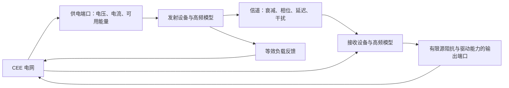

# 高频抽象、功率边界与信号仪器

状态：建议方案。复用 CEE 供电与其可验证的低频电气能力；高频载波单独抽象。无线电、玩家信号处理、麦克风和示波器保持探索方向，具体抽象粒度与音频范围在原型验收时确定。

## 1. 两个域的责任

CEE 决定连接电网的节点电压、电流；高频域推进信号与信道状态。接收输出和发射负载通过模型贡献回到 CEE，不直接覆盖求解结果。跨域时间区间、延迟和状态版本必须显式记录。

供电不足降低发射能力或停机；区间 RF 输出能量不能超过供电输入经效率折算后与可用储能允许的总量。接收端的有源放大从其电源取能，不能把接收信号当作无限能量源。损耗与储能归属固定，避免两域重复记账。

恒功率负载不能无条件使用 `I=P/V`；应规定低压关断、限流、平滑过渡与恢复迟滞。离散边界的预算误差和响应延迟需测试；强耦合若无法稳定，应提出局部接口扩展，不靠覆盖电压隐藏误差。

## 2. 高频表示与采样

窄带信号可用 `s(t) = Re{a(t) exp(j 2π fc t)}` 表示。`fc` 是载波，复包络 `a(t)` 表达幅度与相位；同时记录带宽、调制状态、相位原点、幅度归一化和传播条件，不能只有频率标签。I/Q 与包络属于方法候选，参考资料与访问边界见[来源 I8](../sources.md#i8)。

包络推进速率取决于有效带宽，不需要追踪每个载波周期，但也不能默认降到 20 次／秒。原型应明确选择：低速行为抽象、符号级通信，或独立的分块 DSP。音频／较快调制需要匹配的采样率、抗混叠和有界缓冲。

当前 CEE 微步预算不能自动承载 16/48 kHz 音频。分块 DSP 也不能把同一电网在高采样率下另求一遍；只有明确的设备／子系统端口可进行这种域分离。任意玩家接线无法自动转换成稳定的包络模型。

线性小信号 AC 不能模拟一般大信号混频或检波；需要这些行为时，要用经过验证的非线性或行为模型。HB、通用电路包络与自激振荡器求解是后续研究，不是新增无线设备的必备基础工程。

## 3. 玩家电路与能力声明

低频放大、整流、滤波等先在 CEE 的有效范围内通过真实端口与负载验证。高频模型可以提供明确近似的功能块，但须公布输入、供电、阻抗、带宽、饱和和噪声约束；功能识别不能声称已经逐器件求解任意 RF 电路。

保留玩家构造调制／解调和信号处理的长期方向。若某阶段仅支持预定义收发模型，要在里程碑和界面中明确；不得用 AM/FM 下拉框代替调制结果验证。后续器件级 RF 模型需通过相同参数的参考电路、偏置变化、负载变化及断电测试。

Airwaves 用于交互参考，其重建快照与社区重写必须区分；历史调查不证明本项目已经实现相关能力。[调查](../research/upstream-and-airwaves.md)

## 4. 信道与空间近似

在相同载波与相位参考下，接收包络可由多个发射源延迟、衰减和相位旋转后的贡献相加。幅度增益与功率增益必须区分；相近载波保留频偏和拍频，不能总是只选最强台。

首个原型限定显式天线端口，记录方向、效率、阻抗、有效带宽及距离模型。传播延迟与相位延迟避免重复计算；噪声使用可复现种子。远场近似不能在零距离产生无限增益，近场需明确游戏化规则或单独模型。

按频带重叠和空间索引筛选信道，不为查询强制加载远端区块。首期不承诺任意几何天线、全世界全波场或强耦合近场求解；频谱截断、信道预算和模型范围应可观测。

## 5. 麦克风与示波器

已落地的纯 Java 输入帧、有界缓冲与波形测量基础见[公共信号层](signal-foundation.md)。以下真实采音、换能器与游戏仪器仍是后续接入要求。

麦克风声源范围、播放设备和音频依赖仍待确定。先用确定性测试信号建立输入标定与时间边界，再接真实采音。客户端主动启用采音，服务端处理有界音频帧；帧序号、时间、大小、有限值和归属必须校验。

声学输入通过有源／无源换能器模型映射到有限源阻抗，不能由客户端任意注入电压。音频时钟与 CEE 仿真时间建立显式映射；慢 tick 时采用可说明的丢帧、静音或重采样策略，不无限积压，也不迫使物理时间追赶墙钟。

示波器先读取 CEE 可用波形与时间戳，提供差分电压、触发、窗口内 RMS／平均值和频率。测量窗口与采样不足必须显示；高输入阻抗探头与理想调试探针区分。按观察者订阅环形缓冲，显示抽取保留峰谷或使用滤波。

RF 观测分别标记 I/Q、包络和局部载波重建；重建图像不冒充完整瞬态记录。过期、未收敛、带宽不足和截断不能显示为可信的零值。

## 6. 首条闭环与验收

确定性输入 → 受供电约束的调制模型 → 信道 → 解调模型 → 有限输出端口／示波器。先验证 AM 或另一明确的单一调制，再扩展混频、FM 和真实语音。

验收覆盖供电下降、断电、负载增加、频偏、相位、双源干扰、输出饱和与能量账本。记录所用信号抽象、采样率、误差和延迟；只有在 CEE 实际带宽允许时才将恢复波形完整送入其电气端口，否则限制带宽或明确只提供抽象输出。
