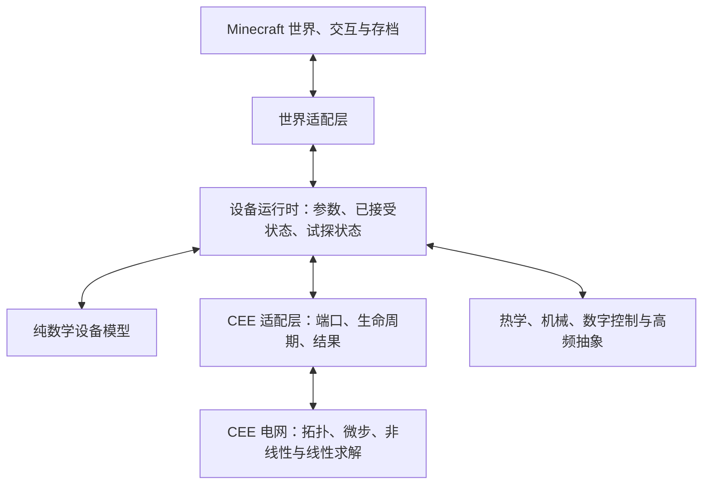

# 设备运行时、时间推进与 CEE 适配

状态：设计基线，接口名称为示意。优先复用 CEE 电网和交流求解，实施顺序见[路线](../roadmap.md)。

### 当前源码落地范围（2026-11-03）

已有 `core.model` 与 `core.runtime`，并新增用于麦克风与示波器的 [`core.signal` 公共信号层](signal-foundation.md)，尚未接入 CEE 或替换游戏设备。模型只依赖 JDK，运行时单向依赖模型；不增加模组内部的版本契约、能力协商、状态版本字段或迁移框架。模组版本匹配交给加载器，持久化由世界侧设备负责，运行时直接接收已读取的参数和物理状态。

- `DeviceModel<P, S, T>` 分离参数、物理历史与数值试探状态。`evaluate` 在未经限幅的最终端电压上计算真实电流；`linearize` 输出完整多端雅可比。限幅后的工作点与求解候选不同时，后续适配器必须继续迭代，不能据此报告收敛。
- `DeviceRuntime` 固定每步参数，按 `prepareStep → linearize → commitStep/discardStep` 推进。提交先完成全部计算，再发布不可变快照；模型异常、失败及 `UNKNOWN` 保留已接受物理状态并标记观测过期。失败区间不补算能量，不实现全网回滚。
- `StepContext`、`DeviceBinding` 和 `StepToken` 只标识运行中的世界会话、设备实例、网络、拓扑修订和微步，不是模组版本协议。重接线立即作废待提交结果；设备移除／卸载时由求解线程关闭运行时，替换设备创建新实例。
- `EnergySample` 表示一个明确时间区间，采用最终工作点矩形积分。热模型消费同一份已接受电气采样，不二次求值或重复记账。快照仅保留最后一个已接受微步，不是波形缓冲或累计测量窗口；后续适配器不能把它当作整游戏刻的平均功率。
- 已有固定热电阻、集中热容、NPN／PNP 与 N／P MOS 纯模型。BJT／MOS 保留现有简化分区和主动限流行为，但补齐控制电压导数，去掉支路调用顺序依赖；迭代用电导下限不冒充物理电流。MOS 的饱和区限流在边界处可能不连续，保留此行为不代表已验证数值稳定性。

初始模型/运行时仅采用 Java 21 独立编译检查；新增信号层有独立回归入口 `scripts/test-signal.ps1`。半导体数值回归、CEE 生命周期验证及游戏内行为验证仍未完成。此处没有把既有设备 `postTick` 改作微步提交点，也没有新增未经目标制品核验的 Mixin。

## 1. 求解权威与分层



同一电气连通网络的节点电压、电流由 CEE 决定。禁止另一套电网求解后覆盖节点数组，也不通过强制写电压来同步两个求解器。离线参考计算和诊断分析不回写运行中电网。

建议先按包隔离模型、运行时、CEE 适配器和世界表现，不强制新增 Gradle 模块。纯数学模型不引用 `Level`、BlockEntity、NBT 或 CEE 类型；适配层保留 CEE 的端口、导线、设备注册和持久化关联。

| 数据 | 示例 | 所有者 |
|---|---|---|
| 静态定义 | 端口顺序、单位、额定值、参数与有效范围 | 定义／配置层 |
| 已接受状态 | 温度、电荷、控制状态、历史积分量 | 设备运行时 |
| 试探状态 | 当前候选工作点、线性化量、数值限制器 | 本步求解上下文 |
| 世界表现 | 朝向、光照、声音、粒子、界面 | 世界／客户端层 |

上游已有动态、非线性模型与生命周期入口，但必须对锁定制品核验签名、调用线程、次数及顺序。优先正式接口；需要 Mixin 时集中记录目标版本、原因、影响范围和替代计划。[历史源码调查](../research/upstream-and-airwaves.md)

## 2. 物理时间步与迭代契约

```text
prepareStep(t, dt)      固定本步起点和历史状态
linearize(trialState)  根据候选解贡献方程，可反复调用
commitStep(solution)  仅在本步接受后提交物理状态
discardStep()         丢弃试探状态，保留最近已接受状态
```

非线性迭代十次不代表物理时间经过十个 dt。温度、电荷、燃料、损坏计时及能量账本不得随迭代重复累加；数值限制器可以更新试探值，但不得污染已接受状态。上述阶段借鉴 CircuitJS 的时间步与迭代分层，是本项目拟定契约，并非 CEE 已有同名 API。[CircuitJS 内部说明](https://github.com/pfalstad/circuitjs1/blob/master/INTERNALS.md)

第一阶段沿用 CEE 的固定微步与仿真时钟。适配器必须验证微步前后回调与设备 `preTick/postTick` 的实际时序，不能把游戏刻回调直接当成微步提交点。

如果上游没有暴露本步接受状态，适配器不能自行把“回调结束”解释为收敛。应先补齐最小诊断／生命周期扩展，再开放依赖这一保证的设备行为。单设备回滚不能恢复已推进的整个电网；全网步拒绝、重试和自适应步长必须具备整岛历史状态、源相位及时间一致性，不属于首期承诺。

模型单测可使用独立测试驱动器调用这些阶段；这不构成运行时第二套电气时钟。改变迭代上限而保持 dt 不变时，已接受的物理状态应在误差容限内一致。

## 3. 模型与端口语义

每个模型声明稳定设备 ID、端子顺序、端口电压参考、正电流方向、参数单位与有效范围。参数和结果拒绝 NaN/Infinity。三端器件的端口关系、工作区、反接行为和所需耦合项需明确，先验证 CEE 接口能否表达；不能仅凭现有支路形式判定必须新建内核。

BJT/MOS 首先保留可对照的简化模型，额定电流和主动保护限流应区分；模型修正需要兼容说明。结电容、电荷存储等未实现时，不宣称器件具备真实射频响应。

DAE 的电荷／磁链与静态残差分离可作为长期接口参考，不要求首期引入完整 DAE 框架或多个分析后端。[Xyce](https://xyce.sandia.gov/about-xyce/)

## 4. 收敛、失败与结果有效性

拟议结果至少包含状态、仿真时间、步长、拓扑版本、残差、迭代数和可用的误差信息：

| 状态 | 含义 | 本项目侧处理 |
|---|---|---|
| `CONVERGED` | 满足已约定的收敛判据 | 接受本步，提交状态与能量 |
| `ITERATION_LIMIT` | 达到迭代上限 | 诊断失败，不提交试探状态 |
| `SINGULAR` | 约束奇异或无法完成分解 | 报告关联网络与元件，等待修复 |
| `NON_FINITE` | 输入、中间量或结果非有限 | 拒绝结果，报告来源 |
| `UNKNOWN` | 目标版本不能提供可靠接受状态 | 标注未验证，不能伪装正常收敛 |

超预算、过期拓扑、浮空约束和矛盾理想源另附诊断。故障时可保留最近有效显示值，但必须标记过期；不能继续将其当作新一步的能量输入，也不能用失败值烧毁设备或累计高温。恢复时不得凭空补算失败区间的能量。

历史调查记录 `runSolver()` 使用固定残差平方范数阈值 `1e-2`，到达上限后仍提取结果；这只是待复核的执行路径，不是已经复现的项目缺陷。[历史来源 C2](../sources.md#c2)

收敛判据应通过用例评估电压／电流各自的绝对与相对容差、方程缩放以及解的变化量。未缩放的混合量纲总范数不能直接代表全范围精度。

## 5. 功率与跨域反馈

采用被动符号约定：电流流入电压正端时 `p = v i` 为吸收功率。能量统计只覆盖已接受微步，区间与采样方法显式记录：

`ΔE ≈ Σ vk ik Δtk`

热学和机械按约定间隔汇总电气能量，再更新慢状态并反馈下一边界的参数。供能、储能、散热和机械功不能重复记账。`Vrms × Irms` 是视在功率大小，一般不等于有功功率；三相端间 RMS 应先求瞬时电压差再统计。

数字控制借鉴模拟／事件协调：实际端电压经阈值、迟滞得到输入状态，内部状态机按事件更新，输出以有限驱动能力的源／负载接入 CEE。规定传播延迟、事件生效边界和同刻事件上限，避免零延迟逻辑环；每根导线不另存一份脱离电压的独立布尔真值。[XSPICE](https://ngspice.sourceforge.io/xspice.html)

RF 边界的功率与采样规则见[无线电设计](radio-and-instruments.md)。

## 6. 调度、线程与缓存

历史调查显示 `SimulationTicker.endTick()` 会等待异步计算完成。独立执行器不能保证服务器刻不被拖慢；先测量图构建、优化、矩阵组装、非线性迭代、线性求解、回写及主线程等待，避免重复累加嵌套计时。[历史来源 C2](../sources.md#c2)

世界侧操作保留在正确线程；仿真模型使用输入快照。结果携带世界会话、拓扑版本和仿真时间，拒绝应用到已拆除或替换的设备。区块卸载后不访问未加载世界，状态驻留策略通过生命周期测试确定。

| 变化 | 失效范围 |
|---|---|
| 增删导线、端口、元件 | 拓扑、节点映射、稀疏结构、数值分解 |
| 电阻、非线性工作点或积分步长变化 | 数值矩阵与分解；结构可能可复用 |
| 独立源数值变化且矩阵系数不变 | 可能只更新右端向量并复用数值分解 |

拓扑不变不代表 LU 分解可复用。先定义分层失效标记并测试，再实现缓存。EJML 或 KLU 仅在线性求解已被证明是瓶颈时比较，选型还需验证非对称／不定矩阵支持、精度和部署成本。[候选资料](../sources.md#i9)

## 7. 分析方法的边界

| 问题 | 当前路线 |
|---|---|
| 低频交流波形、整流与开关 | 复用 CEE 时域求解，验证适用步长和模型 |
| 小信号频响与相位 | 可先离线分析；不与时域 AC 混为一谈 |
| 高频载波与通信 | 独立复包络／行为抽象，经端口耦合 |
| 任意非线性 RF 电路、HB、自适应积分 | 研究候选，须有需求、参考解及预算后另立决策 |

小信号 AC 不能自动产生大信号混频、检波或自激启动；已有时域 AC 也不等于支持任意 RF。增加这些能力不能作为未经验证就替换 CEE 的理由。
